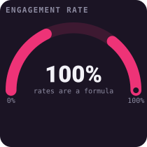
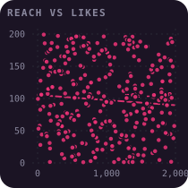
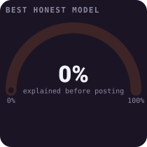
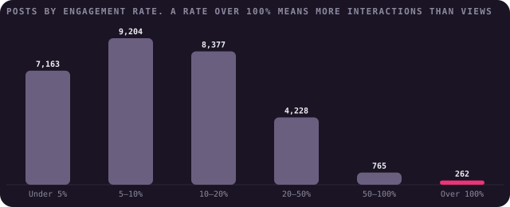
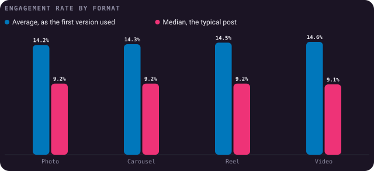
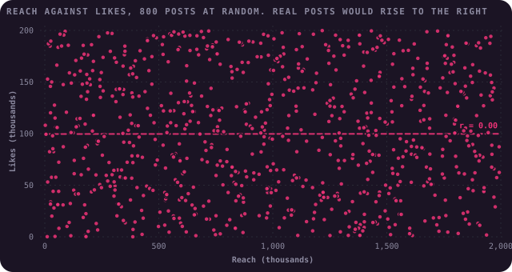
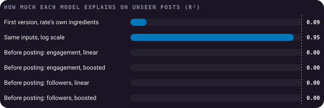

# What Can 30,000 Instagram Posts Tell You?

**An audit of 29,999 Instagram posts from a popular Kaggle dataset: what drives engagement, and why the honest answer
is "nothing in this data".**

[](https://github.com/ShazMoghaddam/Instagram-Analysis/actions/workflows/checks.yml)
[](https://pypi.org/project/bezel-charts/)
[](LICENSE)

Do Reels beat photos? Which topics win followers? The first version of this project answered those questions with
confidence. This rebuild checks the data first, and finds that every column was drawn at random. So the useful findings
are about the checks: how to tell a pattern from a formula, and a formula from chance.

<p align="center">
  
  
  
</p>

> **Every chart here is drawn with [bezel-charts](https://pypi.org/project/bezel-charts/), an open-source Python library
> created by Shaz Moghaddam, the author of this project.** It turns pandas data into clean, self-contained SVG charts.

---

## Key findings

<!-- key-findings:start -->
### The engagement rate is a formula, and some of it is impossible

Every post's engagement rate is exactly its likes, comments, shares and saves divided by its impressions. So it can't
be predicted from those columns in any useful sense, only recomputed. And 262 posts have more interactions than
impressions, giving rates as high as **3,260%**.



### No format wins

The first version said Reels and videos engage more. The typical post in every format has a median rate between
**9.1% and 9.2%**, and the gap in averages it relied on is the size chance produces (p = 0.54).



### Nothing here is related to anything

On a real account, posts that reach more people get more likes. Here the correlation is **0.00**, and no two counts
are linked more strongly than 0.01. The data looks like numbers drawn at random.



### The first model was circular, and honest ones predict nothing

Fed the rate's own ingredients on a log scale, a simple model explains **95%** of it. Given only what's known
before posting, the best model explains **0%**: no better than guessing the average.


<!-- key-findings:end -->

**[Read all seven findings, and what the data is good for →](findings/README.md)**

| # | Finding | |
|---|---|---|
| 1 | The engagement rate is a formula | And 262 posts score over 100% |
| 2 | No format wins | Reels, videos, photos and carousels are level |
| 3 | No category gains more followers | Every topic averages about 500 |
| 4 | Nothing here is related to anything | Not even reach and likes |
| 5 | The data was generated | Five fingerprints, and how to spot them |
| 6 | Chance alone produces "findings" | And how to tell |
| 7 | The first model was circular | Honest models predict nothing |

---

## Run it yourself

You'll need Python 3.11 or newer. The data is in the repo, so there's nothing to download.

```sh
git clone https://github.com/ShazMoghaddam/Instagram-Analysis.git
cd Instagram-Analysis
python3 -m venv .venv && source .venv/bin/activate
pip install -r requirements-dev.txt

python findings/build.py    # charts and report
pytest                      # checks the data and the numbers
```

Or open [`notebooks/instagram_analysis.ipynb`](notebooks/instagram_analysis.ipynb) for the same analysis with the
working shown.

## What's in the repo

```
├── data/
│   ├── instagram_analytics.csv   The Kaggle file, unchanged
│   └── sources.json              Where it came from
├── findings/
│   ├── analysis.py               Every calculation, as small functions
│   ├── charts.py                 Every chart
│   ├── build.py                  Writes the charts and the report
│   └── README.md                 The full report
├── notebooks/instagram_analysis.ipynb
├── charts/                       The SVG charts
├── assets/social-preview.png     The image GitHub shows when the repo is shared
├── tests/                        Checks on the data and the findings
└── .github/                      Automatic checks and dependency updates
```

## Data

The posts come from the [Instagram Analytics Dataset on Kaggle](https://www.kaggle.com/datasets/kundanbedmutha/instagram-analytics-dataset),
published by Kundan Bedmutha. [`data/sources.json`](data/sources.json) has the details. Finding 5 sets out why it
behaves like generated data, so treat it as practice material rather than evidence about Instagram.

Code and content in this repo are [MIT licensed](LICENSE). The data remains subject to its publisher's terms.

---

Created by **Shaz Moghaddam** · London
[Website](https://shazmoghaddam.github.io) · [LinkedIn](https://www.linkedin.com/in/shazmoghaddam)
