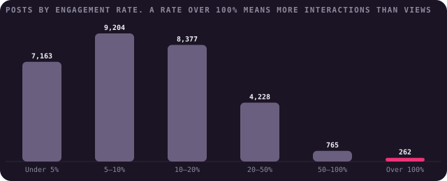
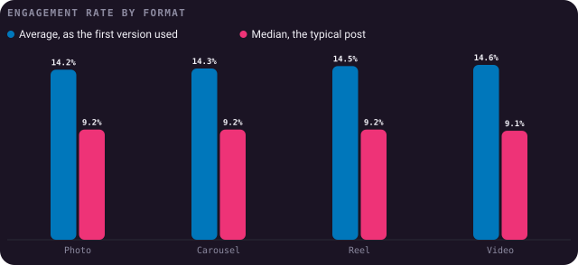
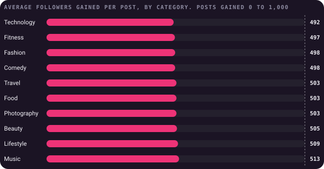
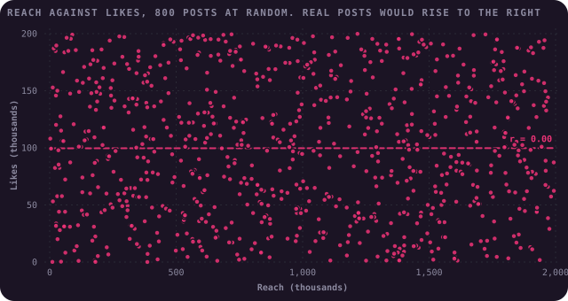
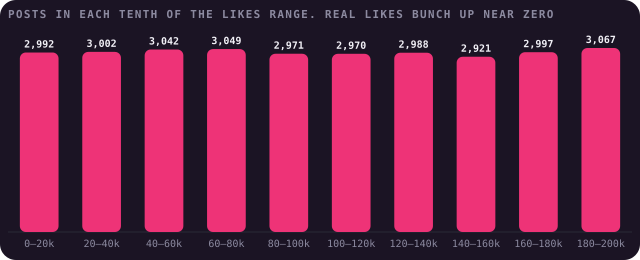
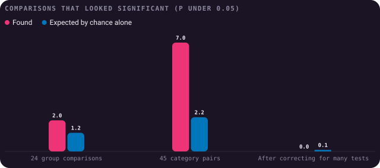
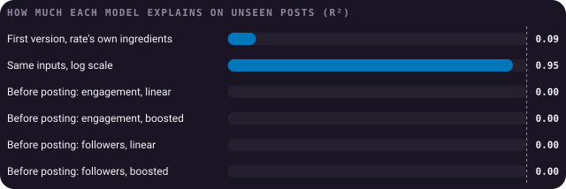

# Findings

What 29,999 Instagram posts from 19 November 2024 to 19 November 2025 can tell you. This page is written by
[`build.py`](build.py), so every number comes straight from the data.

The short answer is: not much about Instagram, and quite a lot about checking data before trusting it. The dataset
behaves exactly like numbers generated at random, column by column, so every pattern below is either built into the
formula or produced by chance.

## 1. The engagement rate is a formula, and some of it is impossible

For **100%** of posts, the engagement rate equals likes, comments, shares and saves added up and divided by
impressions, to the two decimal places given. Divided by reach instead, it barely lines up (r = 0.21).

That makes the rate a calculation, not a separate measurement. Predicting it from likes, saves and impressions is
predicting a sum from its parts.

262 posts (0.9%) have more interactions than impressions, so their rate is over 100%, as high as 3,260%.
On Instagram an impression is one view of a post, so more interactions than views is implausible. These rows pull
the average rate up to 14.4% when the typical post sits at **9.2%**. Without them the average is 12.9%.
Everything below uses medians or tests that aren't thrown by them.

## 2. No format wins

| Format | Average rate | Median rate |
|---|---|---|
| Photo | 14.2% | 9.2% |
| Carousel | 14.3% | 9.2% |
| Reel | 14.5% | 9.2% |
| Video | 14.6% | 9.1% |

The first version compared averages and concluded Reels and videos engage more. The highest average (Video, 14.6%) is
0.4 points above the lowest (Photo, 14.2%), and a Kruskal–Wallis test puts the chance of a gap like
that between identical groups at p = 0.54. Every format's median sits between 9.0% and 9.5% once you allow
for sampling, a 95% bootstrap interval.

## 3. No category gains more followers

The first version said some content categories attract more followers. Posts gained between 0 and 1,000 followers each,
and every category's average falls between **492** (Technology) and **513** (Music).

That spread is what chance gives ten groups of 3,000 posts (p = 0.19).

## 4. Nothing here is related to anything

The first version's scatter of reach against likes was meant to show that more visibility brings more engagement. The
correlation is 0.00. On a real account it would be strongly positive.

The same holds everywhere. Leaving out reach against impressions, which are built together (see finding 5), the strongest link
between any two counts is between shares and impressions, at -0.01. Reels make up 25.7% of posts found through the Reels
feed and 25.1% of posts overall, and format has no bearing on how posts were found (p = 0.39).

## 5. The data was generated

Several fingerprints show the numbers were drawn at random rather than collected:

- **Even spreads.** Real likes pile up near zero with a long tail of hits. Here each tenth of the range from 0 to 200,000
  holds about the same number of posts, and the same is true of comments, shares, saves, reach, caption length and
  followers gained. None of them is distinguishable from an even spread (every test gives p of 0.05 or more).
- **One clock time.** All 29,999 posts were uploaded at 09:25:22, to the same microsecond, on different days. That
  happens when dates are made by subtracting whole days from a single moment.
- **Built columns.** Impressions are reach plus an evenly spread extra of 5 to 499,979.
- **Balanced groups.** Each format is between 24.8% and 25.1% of posts, and the 10 categories and 6
  traffic sources are just as even.
- **A tidy window.** Posts run exactly one year, 19 November 2024 to 19 November 2025.

## 6. Chance alone produces "findings"

Slice data enough ways and some slices will look different. I compared every format, category, traffic source and weekday
on six outcomes: 24 tests. At the usual p under 0.05, chance alone should flag about 1.2. 2 came up, the
smallest at p = 0.046.

Comparing categories two at a time, the way "Beauty beats Travel" headlines are made, 7 of 45 pairs came up against
2.2 expected. That looks like something until you remember the pairs share categories, so one category that's a little
low by chance creates several hits at once. Shuffling the categories at random, so there can't be any real difference,
gives 7 or more hits 8% of the time.

Correcting for the number of tests (Bonferroni), **0** results survive.

## 7. The first model was circular, and honest ones predict nothing

The first version predicted engagement rate from likes, comments, shares, saves, reach, impressions, caption length and
hashtags, on a random split, and called the result reasonable. Rebuilt, it explains 9% of the rate on posts it hasn't
seen. That's low only because a straight line can't follow a division. Take logs, which turn the division into a subtraction, and
the same inputs explain **95%**. It's recovering the formula, not learning anything.

A useful model can only use what's known before posting: format, category, traffic source, weekday, caption length and
hashtags. Trained on 21,061 posts up to July 2025 and tested on the 8,938 after, a linear model and gradient boosting
score R² of 0.00 and 0.00 on engagement rate, and 0.00 and 0.00 on followers gained. Zero means no better
than guessing the average every time.

## What this data can't tell you

- **Anything about Instagram.** The numbers weren't collected from real posts, so they can't show what works on the
  platform. That includes the absence of patterns: a real account would show many.
- **Why the dataset was made this way.** It may have been built for practising code, which it's fine for. It just isn't
  evidence.

## What it's good for

- **Practising a pipeline** on clean, complete data with no missing values.
- **A baseline with no signal.** Any method that finds a strong pattern here is finding its own mistake.
- **Learning to check first.** Every fingerprint above is a check worth running on real data before analysing it.

## How it was worked out

1. [`data/instagram_analytics.csv`](../data/instagram_analytics.csv) is the original Kaggle file, unchanged.
2. [`analysis.py`](analysis.py) holds every calculation as a small, tested function.
3. [`charts.py`](charts.py) draws each chart with [bezel-charts](https://pypi.org/project/bezel-charts/).
4. [`notebooks/instagram_analysis.ipynb`](../notebooks/instagram_analysis.ipynb) walks through the same steps with the working shown.

## A correction to the first version

The first version concluded that Reels and videos engage more, that reach and saves strongly influence engagement, that
some categories attract more followers, and that its linear regression predicted engagement rate reasonably well. None of
these hold. The format and category gaps are the size chance produces, the "influence" of reach and saves is the
formula that defines the rate, and the model was recomputing that formula from its parts. Everything here replaces that work.
